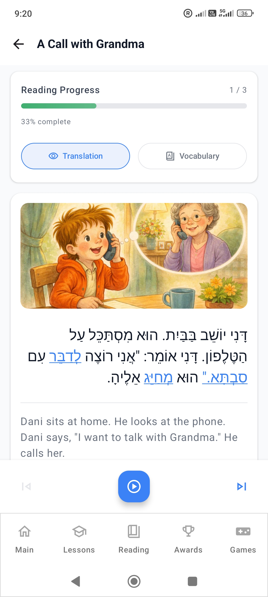

Trois personnes prennent des décisions au sein du projet d'application, selon son créateur : un enseignant, un développeur indépendant et un product owner qui doit penser au marketing. Ce sont la même personne. Et ils ne sont pas toujours d'accord.

Le développeur voit quelque chose d'intéressant à construire. Le product owner voit quelque chose qui pourrait convaincre un apprenant de rester. L'enseignant pose une question moins confortable : est-ce que cela va vraiment apprendre quelque chose ?

Jusqu'ici, c'est généralement l'enseignant qui l'emporte.

Cette tension explique beaucoup de choses sur **Learn Hebrew – Read & Speak**, l'application derrière HebrewEdu. Elle est née près de cinq ans avant l'entretien avec son fondateur, comme un outil pour apprendre l'alphabet hébreu. Elle est devenue depuis un système d'apprentissage plus large, mais la question d'origine la guide toujours : comment aider quelqu'un à comprendre l'hébreu assez bien pour commencer à avancer sans aide ?

*Cet article s'appuie sur un entretien avec le fondateur, mené en russe. Les courtes citations ci-dessous sont des traductions éditoriales en français ; le reste est paraphrasé à partir de l'entretien.*

Le chapitre suivant consiste à porter ce produit d'apprentissage déjà établi vers une autre plateforme. Dans [le récit du fondateur sur le portage de l'application Android vers iOS](/blog/porting-android-app-to-ios-with-ai/) (en anglais), il explique comment des années de choix d'infrastructure et de produit ont façonné le client Swift natif, ce que l'IA a accéléré et comment le portage a aussi amélioré la version Android.

## Une phrase dont tu te souviens, ou un mot que tu sais reconnaître ?

L'objection du fondateur à l'idée de commencer l'hébreu par des phrases toutes faites est très concrète. Imagine apprendre à dire *Shalom ! Shemi Victor…* à partir d'une ligne de transcription en lettres latines. Tu peux répéter une salutation et te présenter. C'est utile, et le plaisir de dire quelque chose de nouveau est réel.

Mais que se passe-t-il quand la transcription disparaît ? Peux-tu reconnaître la salutation en écriture hébraïque ? Retrouver le mot dans un texte ? Le lire sur une enseigne ? Ou as-tu appris une suite de sons restée déconnectée de la langue écrite ?

Pour quelqu'un qui apprend une langue dans une écriture déjà familière, commencer par des phrases peut laisser moins d'obstacles. Pour un débutant en hébreu qui ne sait pas encore reconnaître les lettres, cela peut laisser le fondement intact.

Le fondateur décrit la distinction ainsi :

> « Il y a une grande différence entre savoir et comprendre. »

Ici, savoir veut dire être capable de reproduire quelque chose qu'on a mémorisé. Comprendre veut dire commencer à voir comment cela fonctionne : reconnaître les lettres, les relier à des sons et utiliser ce savoir dans un autre mot. Les deux comptent, mais ce sont deux sortes de progrès différentes.

Son but est de faire passer l'apprenant de l'excitation d'avoir retenu une phrase à la satisfaction, plus discrète, d'être capable de déduire quelque chose par lui-même. C'est pourquoi l'application a commencé par l'Aleph Bet plutôt que par une collection de choses à dire en vacances.

## Une leçon d'alphabet doit mériter ses exemples

L'ambition de départ était modeste : construire un meilleur outil d'apprentissage de l'alphabet hébreu. Un apprenant pouvait s'en servir pour poser les bases, puis continuer avec un oulpan, un enseignant, un manuel ou un autre cours.

Le nom de travail d'origine du projet, **Alef-Bet Tutor**, décrivait fidèlement ce premier objectif. À mesure que le nikoud, la lecture, la grammaire, le vocabulaire, les verbes et Trainer Hub élargissaient son champ, le positionnement public dans les stores s'est élargi lui aussi. Son titre actuel sur Google Play, **Learn Hebrew – Read & Speak**, reflète la distance parcourue par le produit depuis ses débuts d'alphabet.

Mais un bon outil d'alphabet demandait plus qu'une grille de lettres. Le fondateur a imposé une règle aux leçons : un exemple ne doit pas contenir de lettres que l'apprenant n'a pas encore étudiées.

Cela paraît évident jusqu'à ce qu'on essaie d'écrire le contenu. Un mot familier et utile peut faire un mauvais exemple si la moitié de ses lettres sont encore inconnues. La séquence d'enseignement limite le vocabulaire dont dispose l'auteur. La leçon doit être conçue autour de ce que l'apprenant sait déjà, et non autour du souhait de l'auteur de montrer un mot attrayant.

Au début, avec seulement l'Aleph introduit, il n'existe pratiquement aucun exemple de mot qui ait du sens sous cette règle. Dès que le Beth s'y ajoute, quelque chose d'aussi simple que <bdi lang="he" dir="rtl">אבא</bdi> (*aba*, « papa ») devient possible. Les lettres sont familières ; leur combinaison est nouvelle. Les voyelles et les règles de lecture ont encore besoin de leurs propres explications, mais l'apprenant n'a plus à déchiffrer en même temps des formes de lettres inconnues.

L'important, c'est la contrainte : **la nouvelle matière doit s'appuyer sur ce que l'apprenant sait déjà reconnaître**.

Un exemple de départ n'a pas besoin d'être impressionnant. Il doit être lisible. Même un petit mot peut faire passer l'expérience de la copie d'une réponse à la compréhension de la raison pour laquelle cette réponse est juste.

Pour les lettres elles-mêmes, tu peux consulter le [guide complet des lettres hébraïques](/fr/blog/lettres-hebraiques/). L'histoire racontée ici porte sur la raison pour laquelle l'application les introduit dans une séquence contrôlée, et sur ce que cette séquence rend possible ensuite.

## La question qui a fait grandir l'application

Un entraîneur d'alphabet a un point d'arrêt naturel : l'apprenant connaît les lettres. Le fondateur a fini par trouver ce point d'arrêt insatisfaisant. Que se passe-t-il ensuite ?

Le contenu sur l'alphabet est devenu plus substantiel. Chaque lettre a reçu des explications, de la théorie, des exemples et des exercices. Des quiz demandaient aux apprenants de démontrer leurs connaissances avant de progresser. Regarder une leçon et la comprendre sur le moment ne suffisaient plus, à eux seuls.

Un deuxième écart subsistait pourtant. Reconnaître des lettres ne signifie pas automatiquement savoir lire l'hébreu. Un apprenant peut nommer chaque forme à l'écran et avoir du mal à les assembler en un mot.

« De la lettre au mot » est devenu une bonne expression de l'approche pédagogique. Une lettre se relie à un son ; des éléments familiers se combinent en mots ; des règles de lecture rendent ces combinaisons plus intelligibles ; des textes simples leur donnent une raison d'être. La compréhension plus large de la langue se développe à mesure que le vocabulaire et la grammaire entrent dans le processus.

C'est une progression graduelle, pas l'affirmation que chaque apprenant doit terminer un sujet entier avant d'en aborder un autre. Un enseignant ou un cours peut introduire la conversation en même temps que la lecture. Dans l'application, en revanche, l'explication suivante doit avoir quelque chose de solide sur quoi s'appuyer.

Cette question (que peut faire l'apprenant ensuite ?) a poussé l'application au-delà de son rôle initial, limité à l'alphabet.

## Le nikoud est un pont, et il demande du travail

Les voyelles de l'hébreu occupent une place inconfortable pour les débutants. Ce ne sont pas des lettres de l'alphabet, mais elles sont essentielles à une grande partie de la lecture des débuts. Connaître les consonnes laisse l'apprenant devant un autre système à comprendre : les points et les traits appelés nikoud.

Le fondateur ne décrit pas cette étape comme facile. Apprendre à remarquer un petit signe, à le relier à un son et à le lire avec une lettre demande de la pratique. Un contenu dédié au nikoud et des règles de lecture sont nés de cette difficulté.

Les textes d'apprentissage actuels de l'application contiennent le nikoud. Cela donne aux débutants un appui pour la prononciation pendant qu'ils construisent leur connaissance des mots hébreux. Cela ne résout pas la lecture à lui seul. L'apprenant doit encore relier le mot à un sens, le reconnaître à nouveau et apprendre comment il se comporte dans une phrase.

Le vocabulaire change peu à peu l'expérience. Un mot qui demandait autrefois un examen attentif commence à paraître familier. Plus de mots deviennent reconnaissables, et moins d'attention est consacrée à assembler chaque son à partir de zéro. Pour comprendre le système des voyelles, tu peux te tourner vers le [guide du nikoud pour débutants](/fr/blog/voyelles-hebreu/) ; pour aborder un texte ordinaire sans voyelles, lis l'article sur [lire l'hébreu sans voyelles](/fr/blog/lire-hebreu-sans-voyelles/).

Le fondateur a envisagé de permettre aux apprenants plus avancés de masquer le nikoud dans la section de lecture. **C'est une direction possible à l'avenir, pas une fonctionnalité disponible aujourd'hui.** Pour l'instant, les textes d'apprentissage gardent leurs voyelles.

## La lecture est l'endroit où les pièces séparées se rejoignent

Quand on lui a demandé de quelle partie du produit il était le plus fier, le fondateur a désigné la section de lecture.

Le choix se comprend. Un exercice d'alphabet peut établir la reconnaissance. Un court texte demande à l'apprenant de mettre cette reconnaissance au travail tout en suivant quelque chose qui a du sens. Les lettres, les voyelles, le vocabulaire et la structure des phrases cessent un instant d'être des sujets séparés.

La section de lecture de l'application propose des textes adaptés aux débutants, avec des options de traduction, une aide au vocabulaire et un soutien de prononciation et d'audio. Ces outils répondent à des problèmes différents. Tu peux être capable de prononcer un mot sans en connaître le sens. Tu peux comprendre une phrase après avoir lu la traduction, mais avoir encore besoin d'entendre comment ses mots sonnent ensemble.

<figure class="article-screenshot">

<figcaption>Une histoire pour débutants réunit l'écriture hébraïque, le sens et l'audio dans une même séance de lecture.</figcaption>
</figure>

Ce soutien compte, parce que lutter avec tous les éléments à la fois peut rendre épuisant même un texte court. L'intention est de permettre à un débutant de rester dans la lecture au lieu de l'abandonner dès qu'un mot pose problème.

Il y a aussi une distinction utile à garder en tête : suivre une traduction n'est pas la même chose que comprendre l'hébreu de façon autonome. Après avoir utilisé l'aide, reviens à la ligne en hébreu. Repère les mots que tu reconnais maintenant et ceux qui demandent encore du travail. L'article du site sur [pourquoi lire l'hébreu et le comprendre progressent à des vitesses différentes](/fr/blog/lire-sans-comprendre/) explore cet écart plus en détail.

La section de lecture représente un changement important dans la raison d'être du produit. L'application ne se contente plus de préparer quelqu'un à aller lire ailleurs. Elle lui offre un endroit accompagné où commencer.

## Au-delà de « comment on dit ça ? »

Les utilisateurs premium ont accès à une analyse phonétique et de lecture assistée par l'IA pour chaque mot. L'intérêt du fondateur pour cette fonction tient à un problème pédagogique précis, pas à la nouveauté de l'IA.

L'audio peut dire comment un mot sonne. Une transcription peut donner une approximation en lettres latines. Mais l'apprenant peut encore se demander pourquoi ces lettres et ces signes hébreux produisent cette prononciation.

L'analyse de mot tente d'expliquer le lien : comment les lettres, les voyelles et les règles de lecture fonctionnent ensemble. La valeur éducative est dans cette explication. L'idéal, c'est que l'apprenant rencontre un schéma dans un mot et commence à le reconnaître dans un autre.

C'est un objectif pédagogique, pas la garantie qu'une explication de l'IA soit toujours exacte ou complète. Une explication incertaine doit toujours être vérifiée dans le contenu des leçons ou avec un enseignant. L'outil doit aider l'apprenant à raisonner sur la lecture, pas devenir une autorité qu'il doit accepter sans question.

Le fondateur exprime simplement l'objectif à plus long terme :

> « Le résultat idéal de tout manuel, c'est que l'apprenant n'en ait plus besoin. »

D'abord, tu demandes une explication. Plus tard, tu reconnais une partie du schéma avant de demander. À terme, tu peux traiter seul davantage de mots. Le soutien a rempli son rôle quand une partie du travail qu'il accomplissait devient ta propre compétence.

## La transcription peut aider sans devenir le fondement

Le fondateur n'est pas contre la transcription. Une aide temporaire peut rendre un nouveau son moins mystérieux ou aider à vérifier ce qu'on vient de lire.

Son objection porte sur son usage comme fondement de l'enseignement de l'hébreu. Si chaque nouveau mot arrive d'abord en lettres latines, un apprenant peut devenir de plus en plus à l'aise pour lire la transcription tout en restant incapable de reconnaître l'hébreu.

Une question pratique est de savoir si l'aide te ramène vers l'écriture. Peux-tu revenir au mot hébreu et relier sa forme écrite au son ? Peux-tu le reconnaître quand il réapparaît sans transcription en dessous ?

Tu n'as pas à supprimer toute aide immédiatement. Le but est de réduire la dépendance à mesure que la reconnaissance se développe. Une béquille peut être utile tant que tu en as besoin ; elle doit t'aider à avancer vers plus d'autonomie.

Ce principe relie la transcription à la section de lecture et à l'analyse de mot. Aucun de ces outils n'est censé remplacer durablement le travail direct sur l'hébreu.

## Grammaire, verbes et une place pour le jeu

Une fois que les apprenants commencent à lire, leurs questions se multiplient. Pourquoi cette forme change-t-elle ? Comment ces mots s'articulent-ils ? Qu'est-il arrivé au verbe ?

L'application comprend désormais un programme de grammaire en pleine croissance. Pour son créateur, présenter la grammaire dans une application a demandé beaucoup de réflexion : une explication peut être correcte et rester trop sèche ou trop difficile à lire sur un téléphone. Les leçons associent à la théorie des exemples, du vocabulaire, des dialogues de débutant et des exercices, pour donner à l'apprenant des moyens d'employer l'explication.

Le programme continue de s'étoffer. Le fondateur envisage la possibilité de développer à terme une base capable de soutenir un niveau débutant d'environ A2. **C'est une ambition pour le programme, pas une affirmation validée selon laquelle l'application actuelle permet ou garantit d'atteindre le niveau A2.**

Les contenus sur les verbes prolongent la même attention portée à la compréhension des schémas. Les racines, les formes conjuguées, ainsi que la référence et les exercices sur les binyanim aident les apprenants à explorer un domaine qui devient souvent frustrant. Selon les apprenants, ces outils servent à des moments différents. Quelqu'un qui suit un oulpan peut ouvrir la référence des verbes pendant qu'un autre apprenant travaille encore sur les voyelles. L'[introduction aux binyanim](/fr/blog/binyanim-hebreu/) du site explique l'idée sous-jacente sans avoir besoin de l'application.

Les révisions de vocabulaire et la répétition espacée apportent un autre type de continuité : revenir aux mots qui demandent plus d'attention. Le dictionnaire permet de chercher un mot au fil des questions. Les fonctions d'apprentissage essentielles sont aussi disponibles hors ligne, pour pouvoir étudier quand il n'y a pas de connexion.

Il y a ensuite Trainer Hub, où des compétences fondamentales comme la reconnaissance des lettres, les mots de base et le nikoud peuvent se pratiquer sous une forme plus ludique.

C'est un des endroits où les trois rôles du fondateur doivent négocier. L'enseignant veut une pratique utile. Le développeur sait construire des interactions. Le product owner sait qu'une étude sérieuse est en concurrence pour l'attention avec des expériences qui offrent une gratification plus rapide.

Son compromis : utiliser le jeu pour pratiquer des connaissances. Les récompenses doivent encourager l'activité plutôt que devenir son unique but. Pour s'entraîner dans le navigateur, la [section Play](/play/) (en anglais) du site propose un espace distinct pour essayer des jeux d'apprentissage de l'hébreu ; ce n'est pas le Trainer Hub de l'application.

L'entretien séparé avec le fondateur sur [ce qui rend un jeu de langue éducatif](/fr/blog/jeux-educatifs-langues/) examine cette tension à travers Alef Bet Rush et Hebrew Mahjong : où va l'attention, comment l'aide peut s'effacer et ce que les apprenants peuvent reconnaître après avoir quitté le jeu.

## Ce que l'application laisse aux gens, au papier et à d'autres ressources

Le nom du produit contient « Speak », mais son créateur ne croit pas qu'une application puisse remplacer entièrement la communication humaine. Pour développer l'expression orale, il faut parler avec des gens.

Une application peut soutenir ce travail grâce au vocabulaire, à la grammaire, à la lecture et à l'écoute d'audio. Elle ne peut pas provoquer une vraie conversation simplement parce que tu as terminé ses exercices. Un enseignant, un oulpan, un partenaire de conversation ou une autre occasion d'utiliser l'hébreu reste important.

L'écriture manuscrite est une autre limite délibérée. L'application se concentre sur l'hébreu imprimé et n'enseigne ni l'écriture manuscrite ni la calligraphie. Le fondateur ne considère pas que tracer une lettre sur un écran tactile équivaut à apprendre à l'écrire. Pour s'exercer à l'écriture manuscrite, son conseil est simple : prends du papier, prends un stylo et écris.

Il n'existe pas de manuel universel qui convienne de la même façon à tous les apprenants et à toutes les compétences. Un apprenant motivé combinera généralement plusieurs ressources.

L'application peut offrir un système d'apprentissage pour une grande partie de l'hébreu de débutant, accompagner un cours, ou devenir un entraîneur de lecture ciblé ou une référence de verbes. Ce sont des usages différents d'un même produit. L'[aperçu du produit sur la page d'accueil](/fr/) montre comment ses principaux domaines d'apprentissage s'articulent.

Son meilleur public est un débutant qui veut apprendre sérieusement, seul ou avec d'autres soutiens. Quelqu'un qui veut seulement quelques phrases de voyage préférera raisonnablement un outil plus simple, centré sur les phrases. Le fondateur l'accepte très bien. Le produit n'a pas à convenir à tous les usages.

## Que regarder après un mois d'étude

Un mois est une mesure de temps écoulé. Il dit peu de choses sur ce qui s'y est passé.

Le fondateur accorde plus de valeur à la discipline et à la régularité qu'à l'accumulation rapide d'étiquettes de leçons terminées. Se précipiter sur les explications peut produire un bel écran de progression tout en laissant la reconnaissance et la lecture incertaines.

Son estimation pratique est qu'un débutant assidu peut souvent parcourir l'alphabet en sept à dix jours environ, avec une étude régulière. C'est une observation, pas un calendrier universel ni la promesse d'une lecture courante. Terminer le contenu sur l'alphabet et se sentir à l'aise pour l'utiliser sont deux étapes différentes.

Pour un débutant qui se demande si son étude fonctionne, des questions plus utiles sont :

- Est-ce que je reconnais les lettres imprimées, y compris leurs formes finales ?
- Est-ce que je m'habitue à lire de droite à gauche ?
- Est-ce que je sais utiliser le nikoud de base pour lire un hébreu vocalisé élémentaire ?
- Est-ce que j'apprends de nouveaux mots en écriture hébraïque et que je les reconnais à nouveau ?
- Est-ce que je consacre un temps d'étude concentré, et ai-je progressivement moins besoin de transcription ?

Ces questions révèlent ce qu'un nombre de leçons ne montre pas. Elles suggèrent aussi quoi pratiquer ensuite. Si les lettres sont familières mais que la lecture simple reste difficile, passe du temps à les combiner avec les voyelles. Si la prononciation devient plus facile mais que le sens manque, accorde plus d'attention au vocabulaire.

Commence par l'alphabet, puis ajoute progressivement les mots, le nikoud, la lecture simple, l'enrichissement du vocabulaire et la grammaire. Garde un travail régulier. Tu n'as pas besoin de transformer chaque séance en test, mais vérifier de temps en temps ce que tu sais faire sans aide rend les progrès plus visibles.

Quand quelqu'un trouve l'hébreu intimidant, le fondateur veut d'abord savoir pourquoi cette personne veut l'apprendre. La motivation donne un but à l'effort. L'écriture peut d'abord ressembler à des symboles incompréhensibles ; étudier l'alphabet commence à les transformer en système. Le nikoud demande plus de travail, et un vocabulaire qui s'enrichit rend peu à peu plus de choses reconnaissables dans la langue.

## Le temps d'écran aurait dû valoir la peine

Près de cinq ans passés à faire une application apportent des éloges, des critiques, des suggestions, des rapports de bugs et, parfois, des plaintes difficiles à exploiter. Le fondateur accepte ce mélange comme faisant partie de la création d'un produit.

Ce qui reste le plus positivement en lui, ce sont les messages directs envoyés à l'assistance. Certains utilisateurs en Israël lui ont écrit pour le remercier d'aider des gens à apprendre l'hébreu ; certains utilisateurs religieux lui ont envoyé des bénédictions. Ce sont le genre de messages qu'il a décrits pendant l'entretien, et non des témoignages reproduits ici. Ils comptent parce qu'ils suggèrent que l'enseignement atteint quelqu'un au-delà de l'écran.

Au moment de l'entretien, il faisait état d'un peu plus de 3 000 utilisateurs actifs. Atteindre au moins 10 000 dans le monde est une ambition à plus long terme. Aucun de ces chiffres ne dit à lui seul si le temps d'un apprenant a été bien employé.

L'objectif plus profond, c'est ce qui se passe quand quelqu'un termine la dernière leçon. Il veut qu'il ait le sentiment que le temps d'écran en valait la peine : qu'il reconnaît plus de choses, comprend plus de choses et commence à faire seul ce qui demandait de l'aide auparavant.

C'est le fil qui relie l'entraîneur d'alphabet d'origine à l'application plus large. Mémoriser quelque chose peut être un début. Le reconnaître est une autre étape. Comprendre pourquoi cela fonctionne ouvre la possibilité d'utiliser ce savoir ailleurs.

Et quand un apprenant commence à en faire davantage sans l'outil, l'idée pédagogique a atteint son but. La suite consiste à continuer de franchir ces étapes.
