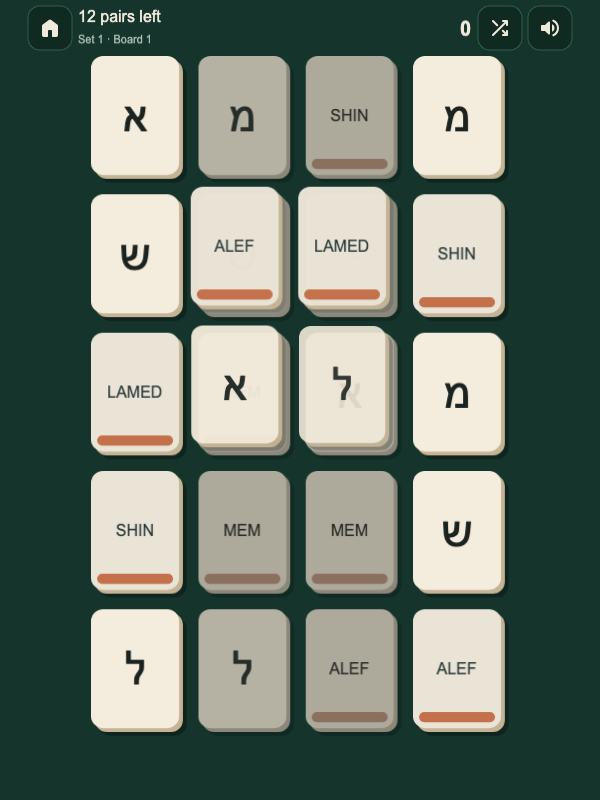

Un garçon de neuf ans, le fils du fondateur de HebrewEdu, venait de jouer à Hebrew Mahjong avec son père. Il était enthousiaste de ce qu'il avait appris : « Papa, maintenant je vais savoir lire l'hébreu. »

Il ne savait pas encore lire l'hébreu et ne connaissait pas le système de voyelles du nikoud. Mais plus tard, quand son père lui a montré <bdi lang="he" dir="rtl">שלום</bdi>, il a reconnu des lettres rencontrées dans le jeu, dont <bdi lang="he" dir="rtl">ש</bdi> et <bdi lang="he" dir="rtl">ל</bdi>.

C'est un résultat plus modeste que « un jeu a appris à un enfant à lire l'hébreu ». C'est aussi un résultat plus intéressant. Des formes jusque-là inconnues devenaient reconnaissables dans un mot, loin du plateau sur lequel il s'était entraîné.

L'expérience d'une seule famille ne permet pas de savoir dans quelle mesure un jeu enseigne à d'autres apprenants. Elle suggère en revanche une question utile : **que reste-t-il quand le jeu n'est plus là ?**

Un niveau terminé dans une interface prouve que quelqu'un sait terminer ce niveau. Savoir reconnaître la même langue ailleurs est une autre question. Cette distinction est devenue le cœur d'un entretien avec le fondateur sur la philosophie pédagogique de HebrewEdu Play.

*L'entretien a été mené en russe. Le souvenir d'ouverture et les courtes citations du fondateur sont des traductions éditoriales en français. Les principes de conception et les observations relèvent de sa position pédagogique, et non d'une efficacité scientifiquement établie.*

## Le résultat doit apparaître après le jeu

Pour un jeu d'alphabet, le test hors du jeu peut rester modeste. L'apprenant sait-il retrouver une lettre familière dans un mot ? La reconnaître sur une enseigne, dans une autre interface ou dans une ligne de texte ?

Pour le vocabulaire, la question change. Comprend-il un mot sans l'image précise qui l'accompagnait toujours ? Pour les phrases, sait-il choisir une réponse adaptée quand la situation change ?

C'est ce que le fondateur appelle la **transférabilité** : la compétence travaillée survit à un changement de contexte. Progresser dans un jeu compte quand ce progrès inclut quelque chose que l'apprenant peut emporter ailleurs.

Un apprenant peut aussi devenir excellent pour mémoriser l'endroit de l'écran où apparaît une réponse. Ou découvrir qu'une certaine illustration va toujours avec la deuxième option. Ces stratégies peuvent produire un score impressionnant sans toucher à la langue.

La reconnaissance des lettres de <bdi lang="he" dir="rtl">שלום</bdi> par le fils est un petit exemple de transfert, pas une preuve de compétence en lecture. Nommer une lettre, la relier à un son, combiner des sons et comprendre un mot restent des tâches distinctes. Le [guide des lettres hébraïques](/fr/blog/lettres-hebraiques/) et le [guide des voyelles en hébreu](/fr/blog/voyelles-hebreu/) couvrent des bases qu'un jeu d'association ne remplace pas.

## Les jeux sont des instruments ; quelqu'un doit encore diriger

La métaphore de l'orchestre, chez le fondateur, donne aux jeux une place utile. Un manuel, une application et un jeu sont des instruments. Un enseignant peut jouer le rôle du chef d'orchestre : il décide du moment où chacun intervient dans l'apprentissage et de la façon dont les parties s'articulent.

À ses yeux, posséder plusieurs outils ne produit pas automatiquement un parcours d'étude cohérent.

Un jeu peut introduire de la matière. Il peut renforcer une leçon, offrir de la répétition ou faciliter la pratique en autonomie. Mais s'entraîner à reconnaître des lettres ne couvre pas tout ce dont un débutant a besoin pour lire, écouter, comprendre ou parler.

La question pour l'apprenant ou l'enseignant est donc précise : quel travail ce jeu fait-il aujourd'hui ? Si la réponse est « revoir quelques lettres avant de lire », le jeu a une mission claire. Si la réponse est « apprendre l'hébreu », la promesse est trop large pour être évaluée.

## Où va l'attention du joueur ?

Le fondateur se méfie des coffres au trésor, des gemmes qui clignotent, des pièces et des séquences de récompenses élaborées quand elles deviennent la principale raison d'interagir. Son objection porte sur l'endroit où va l'attention.

Un beau plateau peut rendre les lettres agréables à observer. Un court son peut confirmer une paire. Une animation peut rendre clair le résultat d'une réponse. Ces choix servent l'activité.

Mais imagine un joueur dont le souvenir le plus net est le coffre qui s'ouvre après cinq réponses. La lettre a-t-elle reçu une attention soutenue, ou n'était-elle qu'un obstacle sur le chemin du coffre ? Si le joueur tient surtout à un nouveau skin, le système de récompenses réussit peut-être très bien selon ses propres critères, tandis que la tâche éducative reçoit très peu d'attention.

Ajouter des récompenses à un exercice, c'est ce qu'on appelle souvent la ludification. Construire un jeu autour d'une action d'apprentissage est un autre défi de conception. Aucune de ces étiquettes ne tranche la question. Regarde ce que le joueur remarque, décide et fait de façon répétée.

Un bon test consiste à se demander ce qui se passerait si la langue disparaissait. Si l'on retrouvait essentiellement le même jeu satisfaisant, avec des appuis arbitraires à la place de la reconnaissance, le mécanisme d'apprentissage est peut-être secondaire.

Le fondateur veut que les récompenses ramènent l'attention vers la langue. Il ne veut pas que la langue devienne le péage à payer pour accéder aux récompenses.

## Le plaisir a aussi un rôle

Il existe une autre façon d'échouer : construire un exercice parfaitement respectable dont personne n'a envie de recommencer.

Le fondateur voit deux mauvais extrêmes. D'un côté, l'entraîneur aride, qui exige assez de motivation pour que seuls les apprenants les plus déterminés reviennent. De l'autre, le divertissement vide, où la langue occupe un petit coin d'une boucle de récompenses bien plus captivante.

Son juste milieu : le plaisir doit venir de la réussite de l'action d'apprentissage. Reconnaître une lettre permet un choix satisfaisant. Trouver la bonne paire libère une partie du plateau. Le plaisir et la pratique se produisent tout près l'un de l'autre.

Dans cette vision, le plaisir nourrit la régularité. Une activité qui paraît efficace sur le papier peut offrir peu de pratique si l'apprenant l'abandonne. Une activité moins austère peut être plus utile si l'on y revient volontiers et si l'on continue à prêter attention à la matière.

Le but n'est pas de divertir entre deux exercices. C'est de faire de l'exercice lui-même quelque chose à quoi l'on a envie de revenir.

## L'action du jeu doit correspondre à l'action d'apprentissage

Pendant l'entretien, le fondateur a révisé l'une de ses propres règles.

La version précédente disait que la langue devait toujours servir d'outil dans un jeu, plutôt que d'en être la cible. Pour le vocabulaire, cela peut être un défi productif : par exemple, un personnage demande quelque chose, et le joueur a besoin du mot pour choisir ce qu'il doit lui donner.

Mais la règle était trop rigide pour les lettres. Si le but est de reconnaître un nouveau symbole et de l'associer correctement, la reconnaissance est déjà un travail utile. Inventer un scénario de jeu de rôle compliqué autour de l'Aleph pourrait compliquer l'interface sans améliorer la tâche.

Il a accepté cette objection. Le principe révisé était plus simple :

> « L'action du jeu doit correspondre à l'action d'apprentissage. »

Pour les lettres, cette action peut être la reconnaissance. Pour les mots, il peut s'agir de déduire un sens à partir du contexte, ou de choisir un objet ou une action. Pour les phrases, il peut s'agir de construire un message ou de réagir de façon appropriée à une situation.

Cela protège de deux erreurs différentes. Un objectif d'apprentissage simple peut disparaître sous une complexité de jeu inutile. Un objectif complexe peut être réduit à un quiz qui ne demande jamais à l'apprenant d'exercer la compétence dont il a réellement besoin.

### Deux jeux d'alphabet, deux façons de pratiquer la reconnaissance

[Alef Bet Rush](/play/alef-bet-rush/) (en anglais) est, au fond, un quiz de reconnaissance. L'apprenant découvre d'abord la matière, puis identifie la bonne lettre hébraïque parmi plusieurs propositions. Ses planètes et ses groupes de lettres donnent à la séquence un habillage narratif : il y a toujours une destination suivante dans l'univers de l'Aleph Bet.

L'action éducative reste reconnaissable sous ce thème. Pour avancer, il faut identifier des lettres. Le décor spatial donne de la continuité à l'exercice sans qu'il faille inventer une utilité pratique pour chaque symbole.

[Hebrew Mahjong](/play/hebrew-mahjong/) (en anglais) aborde la reconnaissance par l'association. Une paire relie une lettre hébraïque à son nom, plutôt que deux images identiques. L'apprenant reconnaît, associe, écoute et confirme, encore et encore.

<figure class="article-screenshot">

<figcaption>Le premier ensemble de Mahjong limite la matière. Une paire relie une lettre à son nom : pour vider le plateau, il ne suffit donc pas de repérer des formes identiques.</figcaption>
</figure>

Trouver une paire et vider le plateau procurent une satisfaction proche de l'action d'apprentissage. Le travail sur le son et le retour tactile ou haptique, quand ils sont disponibles, contribuent à cette sensation. Ils n'ont pas besoin de devenir un spectacle à part une fois le travail sur la langue terminé.

Les deux mécanismes sont différents, mais tous deux demandent la compétence qu'ils veulent entraîner. Aucun des deux ne doit être pris pour une leçon de lecture complète.

## Une seule nouveauté suffit pour organiser le jeu

Hebrew Mahjong introduit un ensemble limité de lettres plutôt que de confronter le débutant à tout l'alphabet d'un coup. Le fondateur veut que l'apprenant dépense son énergie à reconnaître la matière, pas à se rappeler ce que l'interface lui demande.

Il appelle cette contrainte de conception plus large **One New Thing** (« une seule nouveauté »). À un moment donné, un seul élément vraiment nouveau doit recevoir l'essentiel de l'attention de l'apprenant ; les éléments familiers sont là pour le soutenir.

Sa règle de travail oblige le concepteur à nommer ce qui est nouveau. Est-ce la lettre ? La règle d'association ? La disposition du plateau ? La consigne audio ? Si les quatre changent en même temps, une mauvaise réponse devient difficile à interpréter.

La règle n'impose pas un écran vide. Le Mahjong garde son casse-tête de plateau. La question est de savoir si les exigences environnantes sont assez compréhensibles pour laisser de la place à la tâche linguistique.

Pour qui choisit un jeu, la même question est pratique : est-ce que je galère avec l'hébreu, ou avec le mode d'emploi de ce truc ?

## Une erreur doit indiquer la prochaine pratique

Les deux jeux actuels offrent une correction immédiate. Une mauvaise réponse doit révéler le bon modèle, avec de l'audio quand c'est utile, pour que l'apprenant dispose de quelque chose de mieux à essayer ensuite.

Une version antérieure d'Alef Bet Rush rassemblait aussi les erreurs dans un bilan final qui montrait les lettres à retravailler. Le fondateur a retiré ce bilan parce qu'il donnait trop l'impression d'un examen scolaire.

Cette décision ne signifie pas qu'il faut ignorer les erreurs. Il préfère les utiliser comme un signal interne : montrer de nouveau la matière difficile, sans dresser un inventaire public des échecs. Hebrew Mahjong ramène déjà plus souvent les lettres difficiles.

La séquence visée est **erreur, retour, bon modèle, pratique supplémentaire**. Se contenter de retirer des points laisse de côté ce qui rend la tentative suivante éducative.

Les jeux diffèrent actuellement dans leur gestion de la progression. Alef Bet Rush a des vies : une erreur peut exiger un nouvel essai avant de continuer. Hebrew Mahjong n'a pas de vies. Les erreurs jouent à la place sur la note finale d'une, deux ou trois étoiles.

Le fondateur ne ressent pas personnellement la perte d'un cœur comme une punition sévère. Ayant grandi avec des jeux de plateformes comme Mario, il associe les vies à une nouvelle chance. Mais cette intention seule ne peut pas déterminer ce que vit l'apprenant. Un nouvel essai doit rester abordable et utile, sans enfermer quelqu'un dans des réponses au hasard.

Son fils parvenait en général à finir les niveaux au deuxième ou au troisième essai, alors qu'il partait sans aucune connaissance de l'hébreu. C'est une observation sur un seul enfant, pas une promesse de résultat.

Pendant l'entretien, le fondateur a envisagé un mécanisme de vies et de répétition pour de futures versions de Mahjong ou pour d'autres jeux. C'est une piste de conception, pas une fonctionnalité de Hebrew Mahjong aujourd'hui. La question serait de savoir si ce mécanisme crée de la pratique supplémentaire utile, au lieu de simplement retarder la progression.

## L'aide doit finir par devenir inutile

Les images, le son, le texte et des alternatives simples peuvent donner un point de départ à un débutant. Le fondateur appelle ces aides l'étayage (*scaffolding*).

Mais un soutien permanent peut masquer ce que l'apprenant sait vraiment. Quelqu'un peut reconnaître l'image de façon fiable sans reconnaître le mot. Si chaque consigne utilise la même disposition et le même contexte, la réussite peut dépendre de ces indices.

Pour la conception de futurs jeux de vocabulaire, l'entretien a développé quatre phases d'**étayage dégressif**. C'est un cadre proposé, pas un système déjà en place dans les jeux d'alphabet de HebrewEdu.

### 1. Soutien complet : établir le sens de l'élément

Présente un mot avec une image, un son, du texte et un choix simple. Rends la première rencontre compréhensible sans demander à l'apprenant de résoudre plusieurs problèmes inconnus à la fois. C'est là que l'aide mérite sa place.

### 2. Isolation des canaux : changer l'aide disponible

Retire un canal de soutien. Garde le son et le texte, mais enlève l'image, par exemple. Ou fais entendre le son et demande de choisir parmi des images, sans mot écrit.

La reconnaissance survit-elle quand un indice familier disparaît ? Modifier l'aide disponible peut révéler quelle association demande de la pratique.

### 3. Changement de contexte : laisser le mot voyager

Si « l'eau » apparaît d'abord dans « Je veux de l'eau », rencontre-la ensuite dans « de l'eau froide » ou « Où est l'eau ? ».

Le mot doit survivre au-delà de sa phrase d'origine. Cela rejoint l'idée d'[apprendre le vocabulaire hébreu en contexte](/fr/blog/vocabulaire-hebreu/) : un jeu doit changer l'environnement du mot tout en gardant son sens reconnaissable.

### 4. Pression contrastive : rendre les alternatives significatives

Choisir « eau » plutôt que « chien » et « table » est possible avec une vague idée de la catégorie. Choisir entre « eau », « jus » et « lait » demande une distinction plus précise.

Des alternatives plausibles doivent affiner la distinction, sans transformer la tâche en question piège. Ensemble, ces phases mènent vers une reconnaissance avec moins d'aide et dans un cadre nouveau.

### Quand une aide doit-elle disparaître ?

Le fondateur préférerait observer le comportement plutôt que retirer l'aide parce qu'un minuteur a expiré. Parmi les signaux possibles : plusieurs bonnes réponses d'affilée, des temps de réponse plus courts et moins de changements d'option avant de répondre.

Ce sont des signaux de conception pratiques, pas des mesures directes de la compréhension. Une réponse rapide peut être un hasard. Une réponse lente peut venir d'une distraction ou d'une commande inconnue. Un système d'aide devrait tenir compte de l'ensemble et rester prêt à proposer de nouveau son soutien.

L'aide doit s'effacer à mesure que l'apprenant devient capable de travailler seul.

## Une pratique calme peut rester dense

Le fondateur a délibérément évité tout minuteur visible dans le contexte actuel de l'apprentissage de l'alphabet. Il estime que la vie moderne comporte déjà assez d'exigences pour se presser ; des lettres inconnues méritent qu'on prenne le temps de les examiner.

La pression du temps conviendra peut-être à un futur mécanisme. Pour l'instant, Alef Bet Rush peut changer de rythme sans transformer la reconnaissance du débutant en test chronométré.

Il distingue la **densité de pratique** de la vitesse. La densité de pratique demande quelle part d'une séance relève d'actions linguistiques utiles. La vitesse demande à quelle rapidité l'apprenant répond. On peut améliorer la première sans exiger la seconde.

Les menus inutiles, les longues animations de victoire, les écrans « Bravo ! » répétés et les clics qui ne correspondent à aucune action d'apprentissage consomment du temps entre deux décisions utiles. Les supprimer permet de réfléchir calmement à chaque lettre tout en faisant de nombreux choix utiles en quelques minutes.

Ses principes de friction minimale dans l'interface et de rythme sans pression vont ici de pair. Laisse l'apprenant réfléchir. Une fois qu'il a répondu et reçu un retour utile, laisse la prochaine interaction utile arriver sans à-coups.

## Quelques minutes peuvent rafraîchir les acquis ; elles ne remplacent pas un cours

Pour le fondateur, le numérique n'est pas automatiquement meilleur. Avec de jeunes enfants, il préfère personnellement des échanges verbaux et visuels dans le monde réel plutôt que d'introduire trop tôt un téléphone.

L'avantage pratique du téléphone, c'est sa disponibilité. Dans le bus, dans une file d'attente ou dans une salle d'attente, un apprenant peut avoir le temps de revoir quelques éléments familiers sans transporter de fiches en papier.

Ces petits moments peuvent avoir un objectif modeste et clair : rafraîchir une lettre, revoir un mot ou remettre en usage une matière déjà étudiée. Le fondateur rejette « apprendre une langue en deux minutes par jour » comme méthodologie complète.

Une courte séance a sa place à côté d'un travail plus substantiel. Sa valeur dépend de ce qui se passe pendant ces minutes et de la façon dont cette pratique se rattache au reste du travail de l'apprenant.

## Parfois, la meilleure action suivante est de s'arrêter

Si l'objectif est d'apprendre, garder quelqu'un dans le jeu le plus longtemps possible est une mesure de réussite incomplète.

Le fondateur pousse cette idée plus loin :

> « Un bon jeu éducatif devrait parfois dire au joueur : ça suffit pour aujourd'hui. »

Il imagine un jeu qui encourage une pause après une progression réelle, puis invite l'apprenant à revenir un autre jour pour de la matière familière et quelque chose de nouveau. Cette invite à s'arrêter reste une idée de conception pour l'avenir.

Le principe est plus immédiat : un jeu doit pouvoir protéger l'attention et reconnaître la fatigue. Une partie de plus n'est pas automatiquement le meilleur choix simplement parce qu'on peut convaincre le joueur de la lancer.

Il y a là une vraie tension. Le product owner veut que les gens reviennent. L'enseignant veut que leur temps serve à quelque chose. La position du fondateur est que revenir doit signifier une nouvelle rencontre utile avec la langue, et non l'entretien d'une boucle de récompenses à tout prix.

## Le vocabulaire demande mieux qu'un quiz de traduction plus joli

La reconnaissance est un objectif approprié pour un jeu d'alphabet. Il ne s'ensuit pas que toutes les compétences suivantes doivent utiliser le même quiz.

Pour le vocabulaire, le fondateur veut explorer des situations où le sens permet d'agir : donner à un personnage l'objet demandé, choisir quoi faire, utiliser un objet de façon appropriée. Des choix contrastifs peuvent exiger de distinguer des sens voisins. Construire une phrase à partir de composants peut donner au mot un rôle grammatical et logique.

Pour les phrases, choisir une réponse à une situation peut être plus pertinent que d'identifier une traduction apprise par cœur. Construire un message peut demander encore un autre mécanisme.

Ce sont des pistes pour de futures conceptions, pas des descriptions de systèmes de vocabulaire déjà publiés. Elles comptent ici parce qu'elles montrent comment l'alignement de l'action change avec la cible. L'ambition n'est pas de placer le même exercice mot-traduction derrière des décors de plus en plus élaborés.

Un concepteur peut se poser quatre questions liées : l'action entraîne-t-elle la compétence visée ? Le contexte est-il assez clair, avec une aide qui peut s'effacer ? Les erreurs mènent-elles à un retour et à une répétition utiles ? Le résultat peut-il survivre en dehors du jeu ?

Ces questions résument le cadre du fondateur : alignement de l'action, contexte transparent, dynamiques bienveillantes et transférabilité. Elles sont aussi utilisables sans choisir un produit HebrewEdu.

Les [jeux HebrewEdu Play](/play/) (en anglais) actuels offrent deux petites études de cas : des décisions concrètes à examiner à la lumière d'un cadre encore en développement.

## Que serait un bon usage de dix minutes ?

Quand on lui a demandé ce qui le satisferait, en tant qu'enseignant, après dix minutes de jeu, le fondateur a décrit trois sortes de changements. Ce sont des objectifs, pas des résultats promis en dix minutes.

D'abord, la reconnaissance d'éléments familiers demanderait moins d'effort. L'apprenant passerait moins de temps à se demander « Quelle est cette forme ? » et aurait plus d'attention disponible pour son sens ou sa place dans un mot.

Ensuite, une association deviendrait plus directe : l'élément hébreu commencerait à se relier à un son, à une image, à une fonction ou à une situation, au lieu de toujours passer par un détour par une traduction en anglais ou en russe.

Enfin, l'apprenant serait prêt à reconnaître quelque chose ailleurs : dans un texte, sur une enseigne ou à l'écoute. Ce ne sera peut-être qu'une lettre aujourd'hui. Cela compte quand même si elle est vraiment disponible en dehors de l'écran qui l'a enseignée.

L'enfant qui regardait <bdi lang="he" dir="rtl">שלום</bdi> n'était pas devenu lecteur d'un seul coup. Mais deux formes d'un mot inconnu n'étaient plus inconnues. Pour son père, c'était une raison de prendre la pratique au sérieux.

Un niveau terminé peut garder la trace d'une soirée agréable. Le résultat éducatif, c'est ce que l'apprenant en emporte : un peu moins d'effort, un peu moins d'aide, et quelque chose qu'il saura reconnaître de nouveau. La pensée satisfaisante devient moins « j'ai battu le niveau cinq » et plus « ça, je le sais maintenant ».
